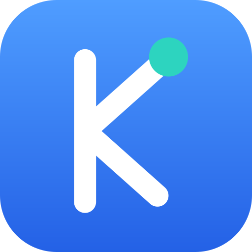
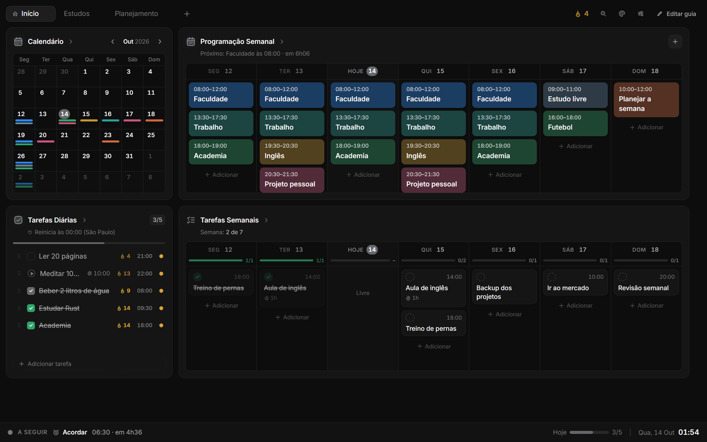
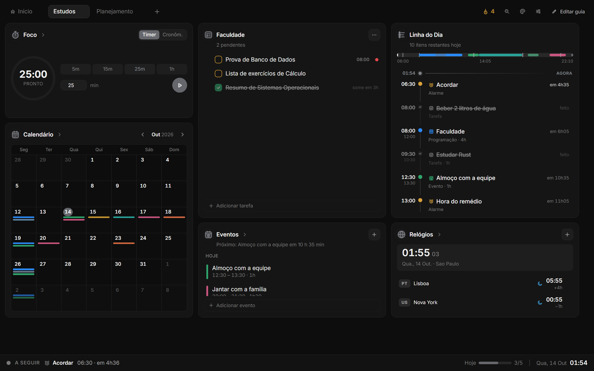
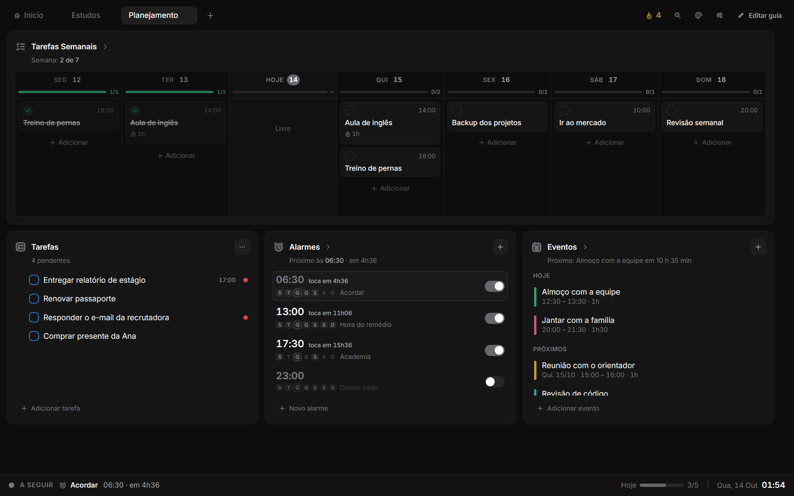
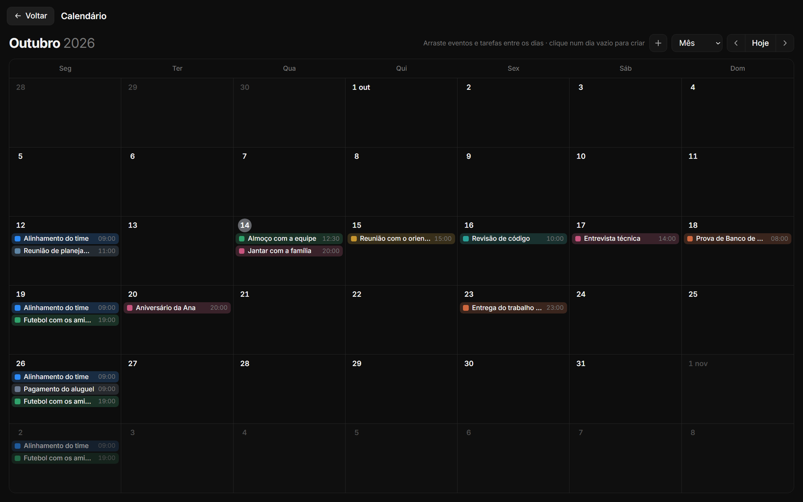
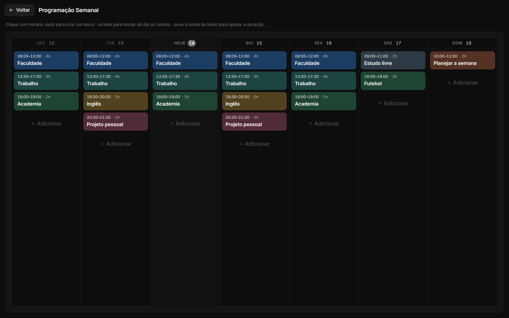
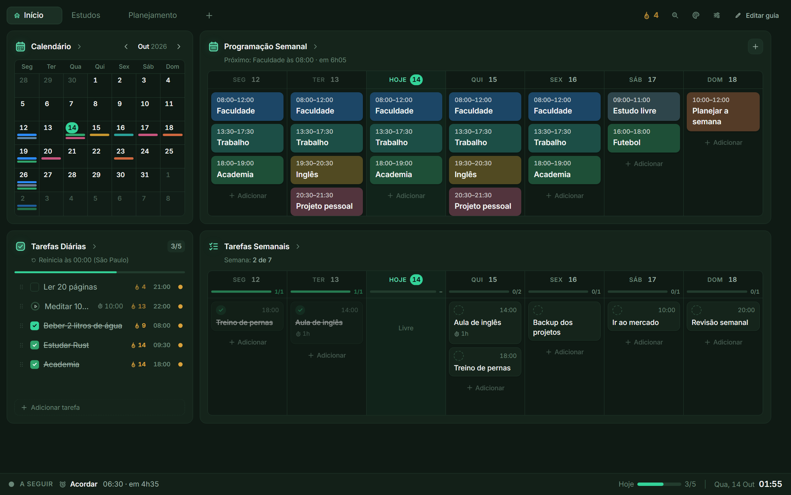
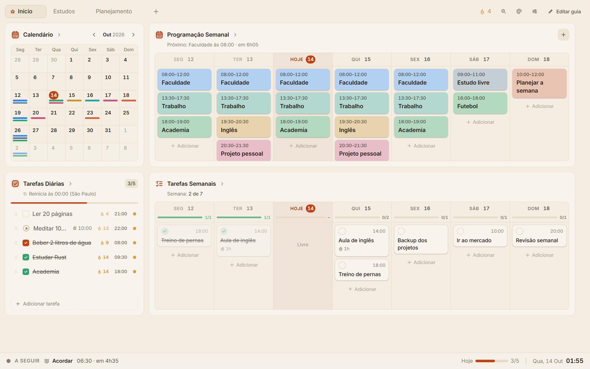
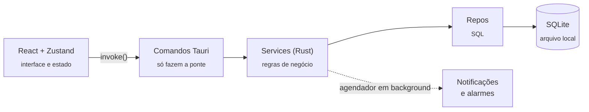

<div align="center">



# Kyra Plan

**Planejamento, tarefas, agenda e foco num só app de desktop — rápido, bonito e 100% offline.**

[](https://github.com/KaueFSS/Kyra-Plan/releases/latest)
[](https://github.com/KaueFSS/Kyra-Plan/actions/workflows/ci.yml)


[](LICENSE)

[**Experimentar no navegador**](https://kauefss.github.io/Kyra-Plan/) &nbsp;·&nbsp; [**Baixar para Windows**](https://github.com/KaueFSS/Kyra-Plan/releases/latest) &nbsp;·&nbsp; [Arquitetura](docs/ARQUITETURA.md) &nbsp;·&nbsp; [Como foi construído](#como-foi-construído)

<br />



</div>

<br />

## O que é

O Kyra Plan junta o que normalmente ficaria espalhado em cinco apps: **calendário, tarefas diárias e semanais, programação da semana, timer/cronômetro, alarmes e relógio mundial**. Tudo roda no seu computador, sem conta, sem nuvem e sem internet.

O painel funciona como o Obsidian: você monta **guias com widgets** que arrasta e redimensiona do jeito que quiser, e cada guia mostra os mesmos dados de ângulos diferentes.

> Projeto solo, do zero: interface, backend em Rust, banco de dados, instalador assinado e atualização automática.

## Destaques

<table>
<tr>
<td width="50%">

### Painel em guias, estilo Obsidian
Widgets livres numa grade 12×12 — arraste, redimensione por qualquer borda, crie guias novas a partir de modelos. Nenhuma tela tem rolagem.

</td>
<td width="50%">

### Campo de escrever que entende você
Digite `Academia seg qua sex 18h` ou `Call mom tomorrow 3pm` e ele monta a tarefa. Entende português, inglês e a mistura dos dois, sugere o que você já escreveu e completa com Tab.

</td>
</tr>
<tr>
<td>

### Sequência de dias
Uma chama no topo conta quantos dias seguidos você fez tudo o que era para o dia. Cada tarefa mostra o próprio histórico.

</td>
<td>

### Tarefas que somem sozinhas
Listas de tarefas avulsas, com várias listas no painel. As concluídas saem depois de um tempo que você escolhe — a lista não vira um cemitério.

</td>
</tr>
<tr>
<td>

### Cores livres
Qualquer cor de fundo e de destaque, no modo claro ou escuro. O app calcula bordas, textos e contraste sozinho para nada ficar ilegível.

</td>
<td>

### Atualiza sozinho
O instalador procura versões novas, confere a **assinatura criptográfica**, instala e reabre. Cada versão publicada traz a lista do que mudou.

</td>
</tr>
</table>

<details open>
<summary><b>Mais telas</b></summary>
<br />

| | |
|---|---|
| <br /><sub><b>Guia "Estudos"</b> — foco, lista da faculdade, Linha do Dia e relógios</sub> | <br /><sub><b>Guia "Planejamento"</b> — semana em colunas, listas, alarmes e eventos</sub> |
| <br /><sub><b>Calendário</b> — eventos e tarefas dentro de cada dia, arraste para remarcar</sub> | <br /><sub><b>Programação semanal</b> — a grade da semana monta sozinha</sub> |

</details>

<details>
<summary><b>Temas: qualquer cor</b></summary>
<br />

| | |
|---|---|
|  |  |

</details>

## Funcionalidades

- **Dashboard em guias** com 11 tipos de widget, guias a partir de modelos e edição livre do layout
- **Calendário** em grade mensal, com eventos recorrentes (diário, semanal, mensal) e tarefas com data
- **Tarefas diárias** que reiniciam no horário e fuso que você escolher (o "dia" não é o do relógio, é o do seu ciclo)
- **Tarefas semanais** em colunas por dia, com progresso e arrastar para remarcar
- **Tarefas avulsas** em listas, na ordem que você quiser (arraste a linha inteira) ou ordenadas por data
- **Tarefas com duração** que contam o tempo de verdade — sobrevivem a fechar o app no meio
- **Programação semanal** que se organiza em tabela conforme você adiciona horários
- **Foco**: timer, cronômetro com voltas
- **Alarmes** e **relógio mundial** com dia/noite e diferença de fuso
- **Linha do Dia**: tudo que tem horário hoje numa linha do tempo, com "agora" e "próximo"
- **Busca global** (`Ctrl + Espaço`) em tarefas, eventos, alarmes e programação
- **Sons** sintetizados na hora (concluir, adicionar, redimensionar, dia completo) — com volume e botão de desligar
- **Notificações do sistema**, bandeja, iniciar com o Windows
- **Ícones desenhados à mão** (mais de 30, duotone), sem biblioteca pronta e sem emojis
- **Atualização automática** assinada, com janela "O que há de novo"

## Como funciona por dentro



| Camada | Tecnologia |
|---|---|
| Interface | React 19, TypeScript, Vite, Tailwind CSS v4, Zustand, dnd-kit, react-grid-layout |
| Desktop | Tauri 2 (instalador NSIS, bandeja, atualizador, notificações) |
| Backend | Rust — `rusqlite`, `chrono`/`chrono-tz`, `tokio`, `thiserror` |
| Dados | SQLite local, com 11 migrations numeradas e nunca editadas depois de publicadas |
| Qualidade | Vitest (frontend) e `cargo test` (backend), rodando no GitHub Actions |
| Entrega | GitHub Actions compila, **assina** e publica o instalador e o `latest.json` |

Sem Electron, sem servidor, sem Python: **um executável pequeno e nenhum dado sai do computador.**

### Decisões que valem a pena olhar

- **O "dia" da tarefa não é o do relógio.** A data do ciclo vem de `cycle_date`, que cruza a hora atual, o fuso configurado e o horário de reset (antes dele, ainda é "ontem"). Isso evita o clássico bug de virada de dia perto da meia-noite ou com fusos diferentes — e tem testes.
- **Timers guardam timestamps, não contadores.** `started_at` + `elapsed_seconds` no banco; o tempo na tela é sempre recalculado. Funciona com a janela minimizada, o processador lento ou o app fechado.
- **Agendador dentro do próprio processo.** Um loop assíncrono em Rust confere alarmes e timers a cada 5 s, então as notificações disparam sem a interface aberta.
- **Eventos recorrentes não duplicam linhas.** Só o evento-base é guardado; as ocorrências são expandidas sob demanda para o período que o calendário pede, com limite de segurança.
- **Histórico por dia, não um booleano.** Cada conclusão é uma linha `(tarefa, dia)`; é assim que existem a sequência de dias e o histórico de cada tarefa.
- **Arrastar atualiza a tela primeiro.** O item fica onde foi solto e o estado real só é recarregado se o backend recusar.
- **Cores calculadas, não escolhidas uma a uma.** Duas cores do usuário viram toda a paleta (superfícies, bordas, textos, contraste do botão) a partir do brilho.
- **Mesmo app em qualquer tela.** A fonte raiz escala com a janela (80–125%) e tudo usa `rem`.

Tudo isso, com os arquivos onde cada coisa mora, está em [docs/ARQUITETURA.md](docs/ARQUITETURA.md).

## Qualidade

- **81 testes automatizados** — 54 no frontend (linguagem natural, sugestões, ordem de listas, agenda do dia, progresso semanal) e 27 no backend (reset diário com fuso, timers, recorrência, alarmes, tarefas, listas, sequência)
- **TypeScript estrito** sem erros e **migrations imutáveis**
- **CI** a cada push: tipos, testes do frontend, testes do backend e build
- **Atualizações assinadas**: o app só instala o que foi assinado com a chave privada do autor

## Como foi construído

O histórico do repositório conta a história, um passo de cada vez:

| Quando | Commit | O que entrou |
|---|---|---|
| 29/09 | [`37a6573`](https://github.com/KaueFSS/Kyra-Plan/commit/37a6573) **SentUtility 1.0.0** (o nome de então) | A base completa: backend Rust com SQLite e migrations, painel em guias e widgets, calendário, tarefas diárias e semanais, programação, foco, alarmes, relógio mundial, busca, tema, ícones próprios, instalador e atualização automática |
| 29/09 | [`993cb45`](https://github.com/KaueFSS/Kyra-Plan/commit/993cb45) Script de release aceita `Cargo.lock` com CRLF | Primeiro ajuste do processo de publicação, descoberto ao lançar |
| 13/10 | [`e076389`](https://github.com/KaueFSS/Kyra-Plan/commit/e076389) Listas de tarefas, sequência, calendário e planners novos, sons e novidades | A grande rodada de produto: listas avulsas, chama de sequência, calendário em grade, planners em colunas, barra de status, cores livres e sons |
| 13/10 | [`71a1b73`](https://github.com/KaueFSS/Kyra-Plan/commit/71a1b73) **Versão 1.1.0** | Primeira versão publicada com essas novidades |
| 13/10 | [`8ede450`](https://github.com/KaueFSS/Kyra-Plan/commit/8ede450) Ordem manual nas listas, som ao redimensionar e campo de escrever mais esperto | Arrastar para ordenar, linguagem natural em inglês, sugestões e completar com Tab |
| 13/10 | [`e407bec`](https://github.com/KaueFSS/Kyra-Plan/commit/e407bec) **Versão 1.2.0** | Publicação da rodada acima |
| 14/10 | [`e4effa0`](https://github.com/KaueFSS/Kyra-Plan/commit/e4effa0) Tarefas recorrentes novas sempre visíveis e Enter do campo não é sequestrado pelo mouse | Dois bugs reais reportados por um usuário, corrigidos com teste |
| 14/10 | [`f897733`](https://github.com/KaueFSS/Kyra-Plan/commit/f897733) **Versão 1.2.1** | Correção publicada — quem já tinha o app recebeu sozinho |
| 14/10 | Demonstração, documentação e CI | Modo demonstração no navegador, este README e a integração contínua |
| 14/10 | Renomeado para **Kyra Plan** · v1.3.0 | Nome e ícone novos, atualizando sozinho para quem já usava o app (veja [como a troca chega a quem já instalou](docs/DESENVOLVIMENTO.md#da-troca-de-nome-de-sentutility-para-kyra-plan)). Nada do que a pessoa criou se perde |

Cada versão tem suas notas em [Releases](https://github.com/KaueFSS/Kyra-Plan/releases), escritas em frases curtas e só com o que foi adicionado.

## Rodar o projeto

**Só ver a interface** (sem Rust, sem instalar nada além do Node):

```bash
npm install
npm run dev
```

O navegador abre com dados de demonstração — é o mesmo código do app, com um backend em memória no lugar do Rust.

**O app completo** (precisa de Rust e das ferramentas de C++ do Windows):

```bash
npm run tauri dev      # abre a janela do app
npm test               # testes do frontend
cd src-tauri && cargo test --lib   # testes do backend
npm run tauri build    # gera o instalador
```

Requisitos, gerar instalador assinado e publicar versões: [docs/DESENVOLVIMENTO.md](docs/DESENVOLVIMENTO.md).

## Instalar

Baixe o instalador (`.exe`) em [Releases](https://github.com/KaueFSS/Kyra-Plan/releases/latest). Instala só para o seu usuário (sem pedir administrador) e se atualiza sozinho dali em diante.

> Como o instalador ainda não tem certificado de editor pago, o Windows SmartScreen pode avisar na primeira vez: clique em **Mais informações → Executar assim mesmo**.

## Autor

Feito por **Kauê** — [@KaueFSS](https://github.com/KaueFSS).

Licença [MIT](LICENSE).
